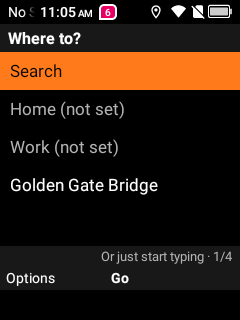
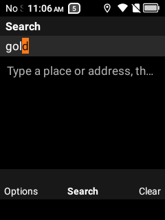
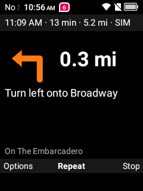
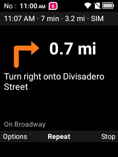
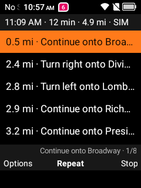

# Fiero Nav

Turn-by-turn **driving navigation for keypad Android flip phones**, built for the TCL Flip 2. It's designed
navigation-first: the D-pad moves through choices and the screen shows your next turn, not a map you have
to pan. Spoken directions keep going with the phone closed.

<p>
  
  
  
  
  
</p>

## What it does

- **Where to?** Home, Work, saved places and recent destinations in one list. Start typing on the number
  keys (multi-tap, like texting) to search. Results nearby come first, with the distance on each row.
- **Route preview:** time, distance, arrival time and the main roads, then Start.
- **Guidance:** big turn arrow, distance to the turn, the instruction, the turn after it when close, arrival
  time and what's left. Spoken prompts ("In half a mile, take exit 235 A on the right toward 15th Street"),
  automatic rerouting when you leave the route, and "You have arrived".
- **Works closed:** a foreground service keeps GPS and voice running with the flip shut or another app open.
  Music ducks while it speaks.
- **No Google needed:** runs on phones without Google Play services. Search and routes come from free
  OpenStreetMap services; no account or API key.
- **Offline fallback:** "Open in OsmAnd" on the route preview hands the trip to
  [OsmAnd](https://osmand.net) if you have it and its maps installed.

## Keys

| Screen | Keys |
|---|---|
| Where to? | ▲▼ move · OK open · **digits type a search** · left soft key: Set as Home / Work, Save, Remove |
| Search | multi-tap letters (2–9, `0` space, `1` punctuation) · Back deletes · OK searches, then opens a result · right soft key clears |
| Route preview | ▲▼ pick a route · OK or right soft key: Start · left soft key: Set as Home / Work, Save |
| Guidance | OK repeats the instruction · `*` voice on/off · ▼ upcoming turns · left soft key: options (reroute, voice, stop) · right soft key: Stop · Back leaves the screen (guidance continues) |

Stray digit keys are ignored on every screen. On some phones an unhandled digit opens the dialer, which
you don't want mid-drive.

## Install

You need [adb](https://developer.android.com/tools/releases/platform-tools) and USB debugging on.

1. Download `fiero-nav-*.apk` from [Releases](../../releases) (or [build it](#build)).
2. Install it and allow location (the app also asks on first start):
   ```bash
   adb install -r fiero-nav-0.2.0.apk
   adb shell pm grant dev.mike.fieronav android.permission.ACCESS_FINE_LOCATION
   ```
3. Open **Fiero Nav** from your app list. With [Fiero Launcher](https://github.com/SuperFieroStatus/fiero-launcher)
   you can put it on a D-pad key.

The phone needs a **data connection** for search and routing, plus a text-to-speech voice (most phones ship
one; the Flip 2 has Pico).

## Limitations

- **No live traffic.** Times assume free-flowing roads.
- **Online only** (except the OsmAnd hand-off). Losing signal mid-route keeps the current route; rerouting
  waits for data.
- **Driving only, English prompts, US units** (feet and miles).
- Uses public servers: [Photon](https://photon.komoot.io) for search and the
  [OSRM demo server](https://project-osrm.org) for routes. They're free for light personal use. If you build
  something bigger on this, run your own or use a paid API.
- Only real-world tested on the TCL Flip 2 so far (Android 11, 240×320, no touch screen).

## Build

Requirements: JDK 17+ and the Android SDK (Android Studio provides both).

```bash
./gradlew assembleRelease     # app/build/outputs/apk/release/app-release.apk (~100 KB, R8-shrunk)
./gradlew testDebugUnitTest   # geometry, units, instruction wording, search ordering
```

Release builds are signed with your **debug key** for convenience; use your own keystore to distribute.
On Windows, `scripts\deploy.ps1` builds, installs, grants location, launches and tails logcat.

### Try a drive without driving

A built-in simulator drives the route at a steady speed, so you can test prompts, rerouting and arrival at
your desk:

```bash
adb shell am start -n dev.mike.fieronav/.GuideActivity \
  --es name "Golden Gate Bridge" --ef lat 37.8078 --ef lon -122.4750 \
  --ef from_lat 37.7955 --ef from_lon -122.3937 --ez simulate true
```

Add `--ef sim_speed 120` to go faster, or `--ez sim_detour true` to leave the route once and trigger a
reroute. Without `from_lat`/`from_lon` it starts from your location. Search without typing:
`adb shell am start -n dev.mike.fieronav/.MainActivity --es query "coffee"`.

## How it works

Plain Kotlin and Android Views, **no dependencies** (HttpURLConnection + org.json). Each GPS fix is matched
to the route line to work out how far along you are; prompts fire at distances scaled by speed; three fixes
off the route trigger a reroute with your heading. [`PLAN.md`](PLAN.md) has the design notes and the phone
findings.

## Credits

Map data © [OpenStreetMap](https://www.openstreetmap.org/copyright) contributors (ODbL). Search by
[Photon](https://github.com/komoot/photon) (Komoot). Routing by [OSRM](https://project-osrm.org).

## Related

- [Fiero Launcher](https://github.com/SuperFieroStatus/fiero-launcher): a keypad home screen.
- [FlipSpot](https://github.com/SuperFieroStatus/flipspot): a keypad Spotify front end.

## License

[MIT](LICENSE)
